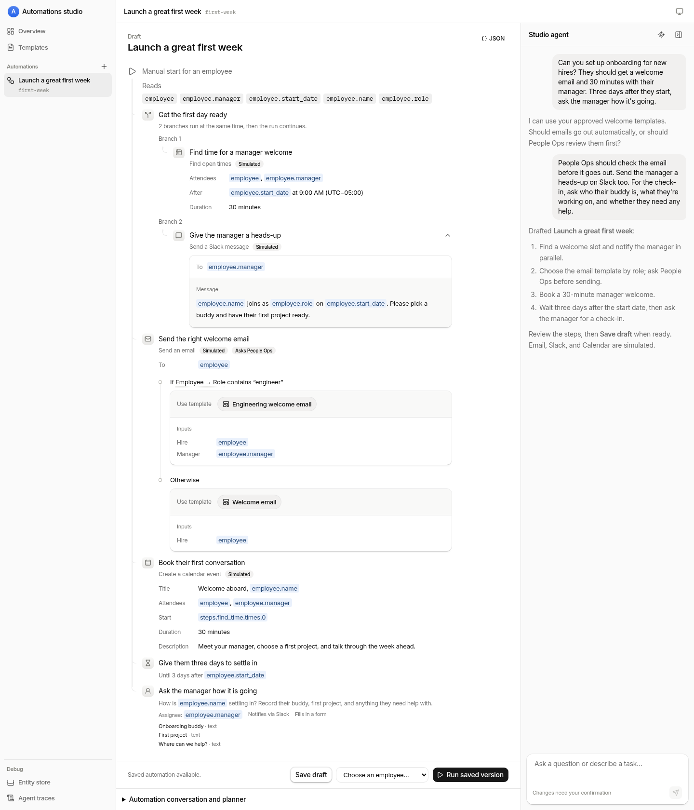

# Automations studio

**Describe the process. Review the plan. Let it run.**

Automations studio turns a conversation into a workflow you can inspect, refine, and run. Coordinate the repetitive work around people and records: welcome a new hire, ask for approval, schedule a meeting, wait a few days, and follow up. Keep people involved where judgment matters, without making them chase every handoff.



_Describe the process, refine it in chat, and review the resulting workflow. “Launch a great first week” is a scripted local demo in the real studio UI; Calendar is simulated, and so are Email and Slack unless you connect [Email](docs/email.md) or [Slack](docs/slack.md)._

## From a description to a running process

1. **Describe what should happen.** Start a new automation with a goal, not a step-by-step specification. The planner drafts the workflow and asks questions when it needs a choice.
2. **Review the steps and permissions.** See what the workflow reads, which messages it will send, and where it waits for a person. Refine it in conversation. Choose which operations run automatically and which need a role’s approval.
3. **Save a version you trust.** Drafting does not change a running process. Runs use the saved version, so you can keep designing without changing work already in flight.
4. **Run it and follow along.** Start by hand, react to a record changing, run on a schedule, or start relative to a date. Watch each run’s results and answer its open tasks in the studio.

## A first week that does not fall through the cracks

The workflow above starts with a request like this:

> Can you set up onboarding for new hires? They should get a welcome email and 30 minutes with their manager. Three days after they start, ask the manager how it's going.

Then refine it:

> People Ops should check the email before it goes out. Send the manager a heads-up on Slack too. For the check-in, ask who their buddy is, what they're working on, and whether they need any help.

It finds a welcome slot and gives the manager a heads-up **in parallel**. It chooses approved email wording based on the hire’s role, pauses for **People Ops to review the exact email**, and books a manager welcome. Three days after the start date, it asks the manager to record the onboarding buddy, first project, and any help the hire needs.

The [example workflow](docs/examples/first-week.json) uses the employee type, templates, and People Ops role included with local setup. Choose an employee with a start date and manager to try it. The screenshot pairs a scripted local conversation with the validated draft; see the [demo details](docs/development.md#readme-demo). `mise run demo:reset` prepares a local studio for the live demo; see [Live demo](docs/development.md#live-demo).

## Workflows with people in the loop

- **Branch, decide, and work in parallel.** Combine connection operations, AI steps, conditions, waits, and requests to people in one readable plan.
- **Reuse approved wording.** Templates keep standard messages consistent while filling in the right details for each record. New runs pick up template edits; runs already going keep their original wording.
- **Ask before acting.** An approval task shows what an operation will send and who can approve it. Human steps can also collect structured answers, not just a yes or no.
- **Keep track of the whole process.** The overview shows runs in flight and how each automation last went. Open a run beside the workflow to review results or answer a task without leaving your draft.
- **Get help across the studio.** The Assistant can prepare changes to records and templates, then delegate workflow design to the planner. Its conversation survives navigation and reload. Proposed data changes require your explicit confirmation; the assistant never saves or runs workflows for you.

## Prototype status

This is a **single-tenant prototype**, not a production-ready service. It runs on Cloudflare and supports long-lived workflows that pause for days or for a person’s response.

Calendar currently **simulates its operations**: it records what would happen but contacts nobody. Email is simulated too until you [set a sender on a domain onboarded to Cloudflare Email Service](docs/email.md), and Slack until you [connect a workspace](docs/slack.md), which lets automations post messages and start from mentions. Human tasks reach people only as Slack DMs, once Slack is connected; otherwise their notifications are recorded rather than sent. HTTP webhooks make real requests. Do not put secrets in workflow definitions. Production use needs further security review; see the [operational caveats](docs/development.md#caveats).

## Development

[mise](https://mise.jdx.dev) installs the pinned tools and exposes the project’s tasks:

```sh
mise trust
mise install
mise run dev
```

Local development needs a Cloudflare profile for Workers AI. The [development guide](docs/development.md#local-development) covers credentials and setup; `mise run dev` prints the studio address.

```sh
mise run typecheck
mise run lint
mise run test
mise run format-check
mise run eval planner --trials 3
mise run check                      # all checks, including real-model evals
```

- [Architecture](ARCHITECTURE.md) — components, storage, the design-to-run lifecycle, and the principles behind them.
- [Development and operations](docs/development.md) — setup, deployment with `mise run deploy`, evals, debugging, and the HTTP/MCP interfaces.
- [Workflow DSL](docs/workflow-dsl.md) — triggers, steps, references, templates, and permissions.
- [Workflow engine](docs/workflow-engine.md) — diagrams of how agents generate a workflow and how runs execute it.
- [Studio assistant](docs/assistant.md) — diagrams of the assistant's hosting, turns, tools, and confirmations.

## Inspiration

- [Callscript](https://github.com/vercel-labs/callscript): turn model output into an inert, validated plan rather than execute it as code.
- [JEXL](https://github.com/just-be-dev/jexl): a programming language whose syntax is pure JSON.
- [Forma](https://forma-lang.com/): schemas, APIs, and policies expressed through one language.
